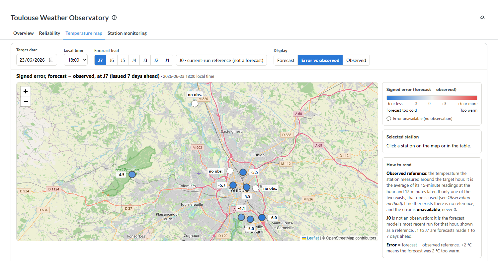
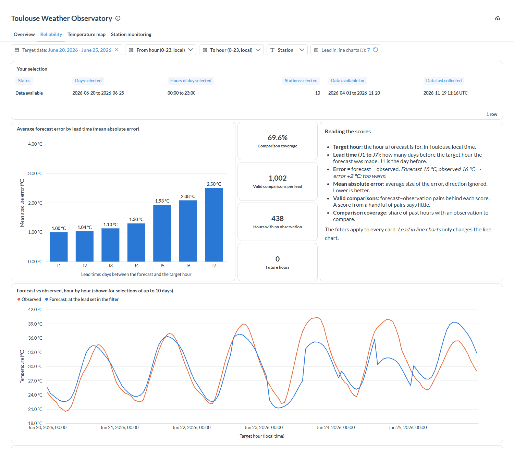
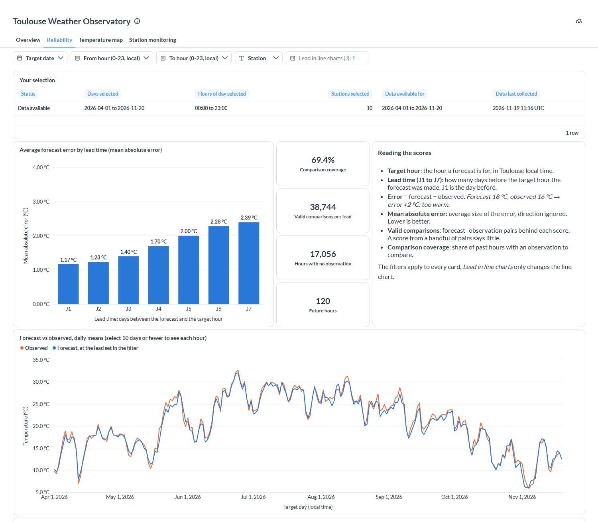
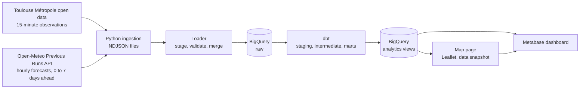

# Toulouse Weather Observatory

Toulouse Weather Observatory measures how accurate temperature forecasts for Toulouse were, by comparing forecasts made 1 to 7 days ahead with what 10 local weather stations then measured.

**[Open the live dashboard](https://metabase-demo-5oxsmpk7aa-ew.a.run.app/public/dashboard/97d4f9e8-e609-42bf-baf7-c2df8759ec05)** (no login). The first load can take a minute or two while Metabase starts; after that, pages respond quickly.



The data covers 1 April to 19 November 2026:

- 447,360 forecast records: one per hour for each of 10 stations and eight lead times, J0 to J7. J1 to J7 are forecasts made 1 to 7 days ahead. J0 is the model's most recent run for that hour; it is a model reference and is excluded from the J1 to J7 scores.
- 151,264 station readings, one every 15 minutes when a station reports.

Both are loaded into BigQuery, modelled with dbt and shown in Metabase.

## Contents

- [Case study: the June 2026 heatwave](#case-study-the-june-2026-heatwave)
- [What the dashboard has](#what-the-dashboard-has)
- [Data sources](#data-sources)
- [Architecture](#architecture)
- [How forecasts are compared with observations](#how-forecasts-are-compared-with-observations)
- [Data coverage](#data-coverage)
- [Quick start](#quick-start)
- [Limits](#limits)

More detail under `docs/`:

- [Local setup](docs/local-setup.md): file formats, the loader, the local Metabase, verification, backfill.
- [Hosted demo on GCP](docs/hosted-demo.md): the Terraform resources, deployment and removal.
- [Data coverage](docs/data-coverage.md): comparison coverage per station and month.

## Case study: the June 2026 heatwave

The peak hour highlighted in this analysis is 23 June 2026 at 18:00 local time. At that hour, the observed reference temperatures at the seven stations with usable readings ranged from 39.0 to 41.4 °C. The map at the top of this page shows the error of the 7-day forecast at each station for that hour.

| Forecast for 23 June, 18:00 | Mean forecast | Mean error | Error range across stations |
|---|---|---|---|
| made 7 days ahead (J7) | 35.1 °C | 5.2 °C too low | 4.1 to 6.0 °C too low |
| made the day before (J1) | 40.0 °C | 0.4 °C too low | 0.9 °C too low to 0.6 °C too high |

The chart below covers 20 to 25 June. The 7-day forecast (blue) follows the measurements (orange) until 22 June, then stays about 5 °C under the afternoon peaks of 23 and 24 June.



Mean absolute error, in °C:

| Period | J1 | J7 |
|---|---|---|
| 1 April to 19 November, all hours | 1.17 | 2.39 |
| 20 to 25 June, all hours | 1.00 | 2.50 |
| 20 to 25 June, 14:00 to 18:00 local time | 0.93 | 3.53 |

Across all hours, the heatwave's forecast errors were close to the April to November averages. During the heatwave, the J7 mean absolute error rose from 2.50 °C across all hours to 3.53 °C between 14:00 and 18:00 local time. The all-hours figures for 20 to 25 June rest on 1,002 comparisons per lead time.

[Open 20 to 25 June in the dashboard](https://metabase-demo-5oxsmpk7aa-ew.a.run.app/public/dashboard/97d4f9e8-e609-42bf-baf7-c2df8759ec05?tab=5&target_date=2026-06-20~2026-06-25&lead=7).

## What the dashboard has

| Tab | What it answers |
|---|---|
| Overview | What the project is, with links to the three other tabs and to the heatwave example |
| Reliability | How the error grows from J1 to J7, for a chosen period, time of day and station |
| Temperature map | For one date and hour: the forecast, the measured temperature and the error at each station |
| Station monitoring | Which stations had missing, late or flagged readings at the latest data collection, and why |

On the Reliability tab, selections of up to 10 days show forecast and observed temperature hour by hour. Longer selections show daily means, so the chart stays readable over several months:



## Data sources

- Observations: 15-minute temperature readings from the Toulouse Métropole weather stations, published on [data.toulouse-metropole.fr](https://data.toulouse-metropole.fr). The 10 stations still reporting on 19 November 2026 are listed in `ingestion/config.py`.
- Forecasts: hourly `temperature_2m` from the [Open-Meteo Previous Runs API](https://open-meteo.com/en/docs/previous-runs-api), which returns what was forecast 1 to 7 days before each hour, at each station's coordinates.

## Architecture



| Folder | Content |
|---|---|
| `ingestion/` | Fetches both sources to local files (`python -m ingestion`) and loads a date window into BigQuery (`python -m ingestion.load`) |
| `transform/` | dbt project: 8 views and their tests |
| `metabase/` | Scripts that build the dashboard and the map page through the Metabase API, and scripts that check them against BigQuery |
| `infra/terraform/` | The hosted demo: Metabase on Cloud Run, its PostgreSQL database on Cloud SQL, the map page in a storage bucket |

The dashboard is defined in code. `metabase/build_dashboard.py` creates or updates every question, filter and tab, so the same script builds the local dashboard and the hosted one.

## How forecasts are compared with observations

A forecast is the temperature at its target hour t (UTC). A station reading timestamped t is the mean over the 15 minutes ending at t. For each station and target hour, the dbt model `int_station_hour_observations` looks up the cleaned readings at t and at t + 15 minutes. The result is the observed reference for that hour:

| Readings found | Observed reference | `observation_method` |
|---|---|---|
| both | their average, covering t − 15 min to t + 15 min | `centered_30min` |
| only the one at t | that reading | `preceding_15min` |
| only the one at t + 15 min | that reading | `following_15min` |
| neither | none | null |

`forecast_comparison` keeps every forecast row. `error_c` is the forecast minus the observed reference, so a positive value means the forecast was too warm. It is null when there is no observed reference: a missing observation never counts as an error of zero.

Lead time is in whole days: J1 is the forecast made the day before the target hour, J7 seven days before. J0 is kept as a model reference and left out of the J1 to J7 scores.

Before the comparison, `stg_observations` removes readings of exactly -50 °C, a value flagged as invalid during data profiling: 918 readings have it, and the next lowest reading in the data is 1.8 °C. It also averages the 101 station and timestamp pairs that the source publishes twice. It does not resample or fill gaps.

### dbt models

| View | One row per | Purpose |
|---|---|---|
| `stg_stations` | station | station label and coordinates |
| `stg_observations` | station and 15-minute slot | cleaned observations |
| `stg_forecasts` | station, target hour and lead time | forecasts, with lead 0 labelled |
| `int_station_hour_observations` | station and target hour | the observed reference that forecasts for that hour are compared against |
| `forecast_comparison` | station, target hour and lead time | every forecast with its observed reference and error |
| `station_monitoring` | station | latest valid reading, recent reporting coverage, flagged readings and a status |
| `station_observation_gaps` | station and missing interval | every run of 15-minute slots with no valid reading |
| `station_daily_observations` | station and UTC day | valid, flagged and expected readings per day |

The tests check keys and accepted values, that every station and target hour has all 8 lead times, that `forecast_comparison` keeps every forecast, and that the gaps add up to the daily missing readings.

## Data coverage

Forecasts are complete: Open-Meteo returned a value for every station, hour and lead time over the whole period.

Observations have gaps in the source. Of the 55,920 station-hours in the period, 38,744 have an observed reference, 17,056 have none, and 120 were still in the future when the data was collected. Six stations have an observed reference for 87% to 100% of past hours. Pibrac (64%) barely reports before late May, Fondeyre (47%) reports about half the time, and Saint-Jory (7%) and Soupetard (1%) rarely report.

The full table per station and month is in [docs/data-coverage.md](docs/data-coverage.md).

## Quick start

This builds the pipeline and the dashboard on your own GCP project and a local Metabase. Commands run from the repository root, in PowerShell on Windows.

You need:

- [uv](https://docs.astral.sh/uv/) and Python 3.12 or later;
- the Google Cloud CLI, after `gcloud auth login` and `gcloud auth application-default login`;
- a GCP project with billing enabled, set as the default with `gcloud config set project <project-id>`;
- Java 21, for the local Metabase.

The project ID `toulouse-weather-demo` is written in `transform/profiles.yml`, `ingestion/load.py`, `metabase/connect_bigquery.py` and `infra/terraform/variables.tf`. Change it there to use your own project.

Load a window of data and build the views:

```
uv sync

# 1. Fetch observations and forecasts to data/raw/ (both dates inclusive)
uv run python -m ingestion --start 2026-11-01 --end 2026-11-18

# 2. First time only: create the raw dataset and load the stations
bq --location=EU mk --dataset raw
bq load --source_format=NEWLINE_DELIMITED_JSON --autodetect --replace raw.stations data/raw/stations/stations.ndjson

# 3. Load the window into raw.observations and raw.forecasts
uv run python -m ingestion.load --start 2026-11-01 --end 2026-11-18

# 4. Build the views and run the tests
uv run dbt build --project-dir transform --profiles-dir transform
```

On a first run, the `raw` dataset and `raw.stations` are the only things to create by hand. The loader creates `raw.observations` and `raw.forecasts` if they do not exist, and its two staging tables on every run. Loading the same window again replaces it without creating duplicates.

Then build the dashboard in a local Metabase:

```
# 5. Start Metabase (needs .metabase/metabase.jar) and leave this terminal open
powershell -ExecutionPolicy Bypass -File metabase\start.ps1

# 6. In a second terminal: connect BigQuery, then build the map page and the dashboard
uv run python metabase/connect_bigquery.py <path-to-service-account-key.json>
uv run python metabase/build_map.py
uv run python metabase/build_dashboard.py
```

`build_dashboard.py` prints the address of each tab. [docs/local-setup.md](docs/local-setup.md) covers each step in detail: where to get the Metabase JAR and the service-account key, what the loader validates, how to check the dashboard against BigQuery, and how to backfill a longer period.

To publish the dashboard on GCP, see [docs/hosted-demo.md](docs/hosted-demo.md).

## Limits

- Uneven station coverage. All stations stay in the scores, with no minimum number of comparisons; check the number of valid comparisons before reading a score.
- Fallback observations are not centred. A `preceding_15min` observation is centred 7.5 minutes before the forecast time and a `following_15min` one 7.5 minutes after.
- An hour with no observation is classed as future or missing by comparing it with the forecasts' `ingested_at`. This is exact only when observations and forecasts are fetched in the same run, which is what `python -m ingestion` does.
- Forecasts are for a model grid cell, not the station itself. The cell centre is 380 to 1,330 m from the station.
- Lead time is in whole days. The Previous Runs API does not give the hour a forecast was issued.
- The data is not refreshed on a schedule. Station monitoring describes the stations when the data was last collected (19 November 2026), not now, and the map page is a snapshot that changes only when it is generated again.
- The map needs an internet connection for the Leaflet library and the OpenStreetMap background. On the night clocks go back (25 October 2026), 02:00 local time occurs twice, and the map shows the first occurrence.
- The hosted demo's database has no backups; the dashboard can be rebuilt from this repository.
- The local Metabase listens on `127.0.0.1` only and keeps its data in an H2 file, which Metabase does not recommend for production use.
